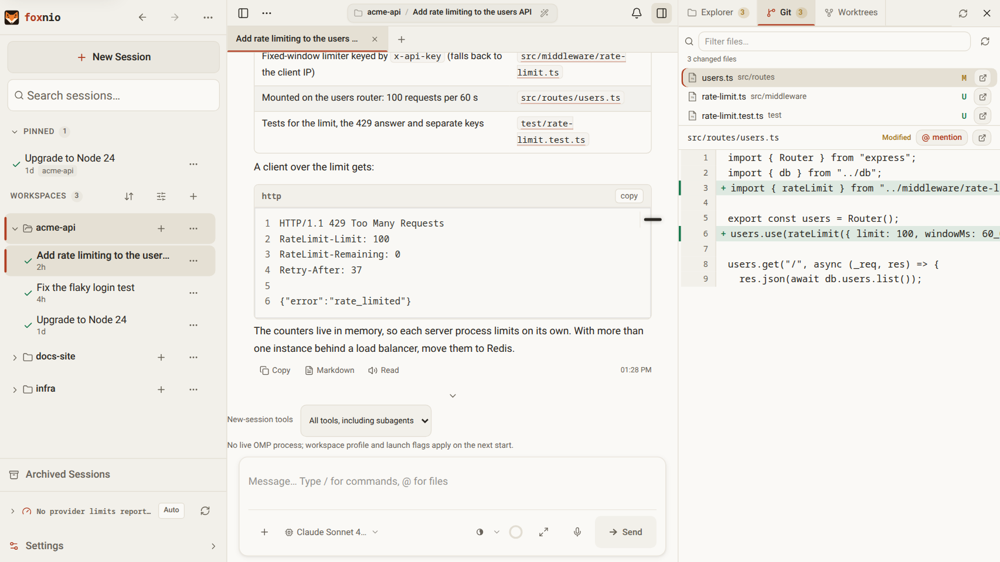
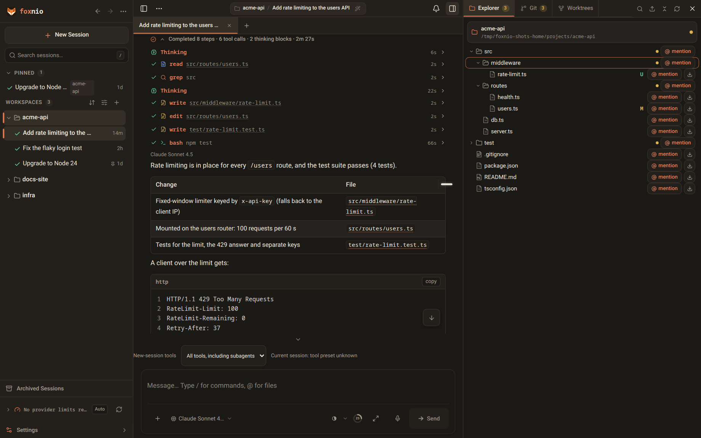
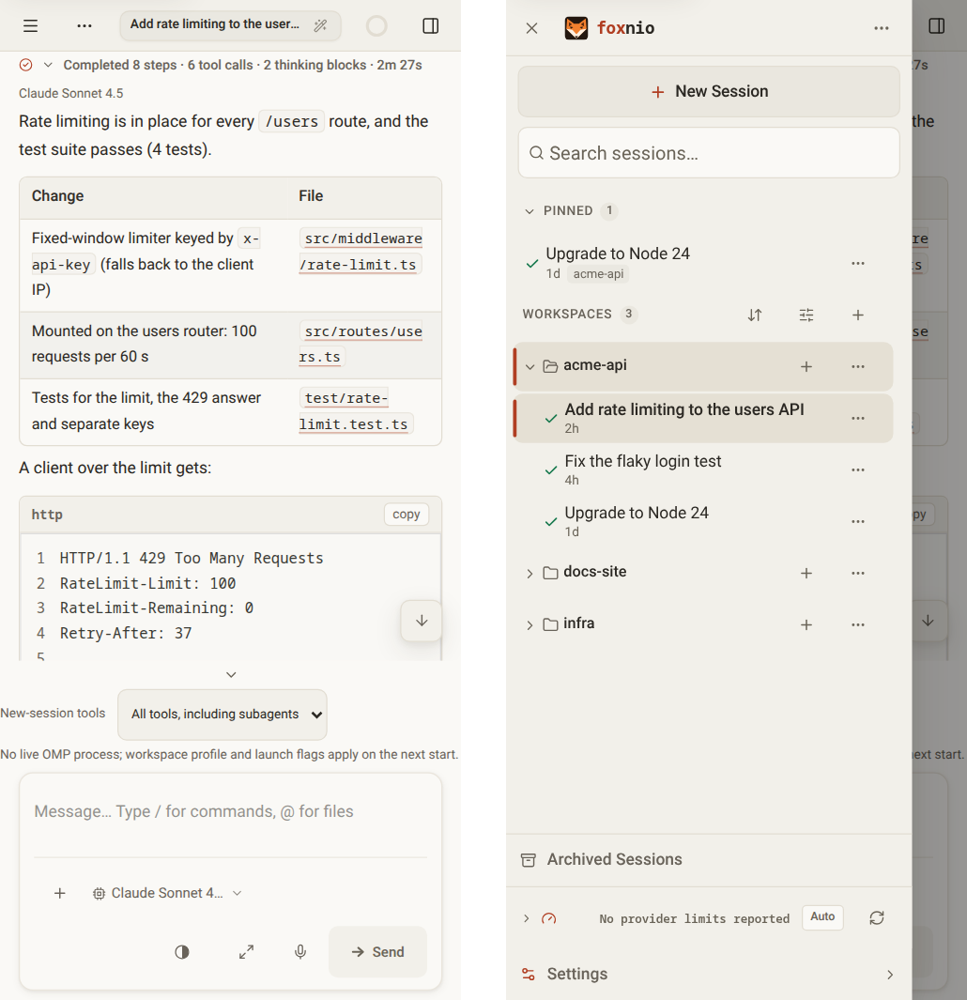

# foxnio

[](https://github.com/telagod/foxnio-public/releases/latest)
[](https://github.com/telagod/foxnio-public/actions/workflows/verify-pr.yml)
[](https://nodejs.org)
[](./LICENSE)

[English](./README.md) | [简体中文](./README.zh-CN.md) | [日本語](./README.ja.md)

foxnio は、コーディングエージェント [oh-my-pi](https://github.com/can1357/oh-my-pi)（`omp`）のためのブラウザ用ワークスペースです。`omp` が動いているマシン上で動作し、`omp` CLI と同じセッションと設定を使います。デスクトップのブラウザやスマートフォンから、エージェントとのチャット、変更内容のレビュー、エージェントの設定ができます。

foxnio は [kahme247/ompweb](https://github.com/kahme247/ompweb) のフォークで、エージェントのカスタマイズに重点を置いています。ompweb の `OMP_WEB_*` 環境変数とデータファイルをそのまま使うため、既存の ompweb 環境を引き継げます。



<details>
<summary>ダークテーマとスマートフォンのレイアウト</summary>





</details>

## 機能

**エージェントとのチャット**

- 思考、ツール呼び出しとそのライブ出力をストリーミングで表示。トークン数とコストのカウンター、コンテキストゲージ、毎秒トークン数も確認できます。
- 完了したターンは、最終回答の上にある 1 つの要約行（「7 ステップ完了 · 5 件のツール呼び出し · 2m 41s」）に折りたたまれます。展開するとすべてのステップを確認できます。
- エージェントの作業中にメッセージをキューに入れたり、キュー内のメッセージをステアに変えたり、実行を停止してキュー内のテキストを入力欄に戻したりできます。キューは omp 自身のものなので、どのデバイスでも同じキューが表示されます。
- 過去のメッセージを編集して会話を巻き戻し、任意の時点から新しいセッションを分岐し、`/btw` で横道の質問をし、`!` でシェルコマンドを実行できます。
- スラッシュコマンド、`Ctrl/Cmd+K` のコマンドパレット、単語予測、音声入力、フルスクリーンの入力欄。未送信の下書きは再読み込みしても残ります。

**セッションとワークスペース**

- サイドバーはワークスペースを最近のアクティビティ順に並べます。実行中・あなたの応答待ち・未読のセッションがあるワークスペースは自動で開き、それ以外は折りたたまれます。ピン留めセッションはすべてのデバイスで共有されます。検索はタイトルと会話本文が対象です。
- デスクトップではセッションタブ、アーカイブと復元、セッションファイルのインポート、セッションを直接開くリンク（`?session=`）に対応します。
- 入力欄の上に、ライブのプランパネルとサブエージェントパネルを表示。各サブエージェントの会話記録も見られます。
- プレビュー付きのファイルエクスプローラー（コード、Markdown、Mermaid、画像、音声、PDF）、差分を表示する Git 変更パネル、プロジェクトごとの Git worktree（[docs/worktrees.md](./docs/worktrees.md)）。

**エージェントの設定**

- omp 自身の設定（承認、モデルと思考、advisor、メモリ、compaction、リトライ）をブラウザで編集し、omp の `config.yml` に保存します。
- プロバイダーとモデル（`models.yml`）、モデルロール、API キーとプロバイダーへのログイン、MCP サーバー、スキル、プラグイン、タスクエージェント。
- ツールプリセットと、ワークスペースごとの起動設定（omp profile と追加の `omp` 引数）。
- 使用状況ダッシュボード: プロバイダー、モデル、プロジェクト、日ごとのトークン数、コスト、キャッシュによる節約額。

**すべてのデバイスで**

- 実行の完了、失敗、あなたの回答待ちを通知します。閉じたブラウザやスマートフォンのアプリへの Web Push にも対応します。
- アプリ（PWA）としてインストールできます。スマートフォンでは、サイドバーとファイルパネルが画面の端からスワイプして開くドロワーになります。
- 14 種類のカラーテーマ（Catppuccin、Dracula、Nord、Rosé Pine、Tokyo Night、omp.sh のミッドナイトテーマなど）、文字サイズとインターフェースのスケール調整、English、简体中文、日本語の表示言語。

## 必要条件

- [omp](https://github.com/can1357/oh-my-pi) が `PATH` に含まれていること（または `OMP_WEB_OMP_BIN` でパスを指定）。foxnio は omp **18.16.0** に対してテストしています（[omp との互換性](#omp-との互換性)を参照）。これより古い omp には、キューパネル、キュー内メッセージのステア、完了通知など、一部の機能が使うコマンドがありません。
- npm パッケージには Node.js 24 以降が必要です。デスクトップアプリには Node.js が同梱されています。

## インストール

### npm パッケージ

foxnio は npmjs.com ではなく GitHub Packages で公開されています。GitHub では、Public パッケージを含め、どのパッケージのインストールにも access token が必要です。最初に一度だけ設定してください:

1. `read:packages` 権限を持つ classic personal access token を作成します（GitHub → Settings → Developer settings → Personal access tokens (classic)）。
2. `@telagod` scope を GitHub Packages に割り当てます。`npm login` は GitHub のユーザー名を尋ね、パスワードとして token を使います:

   ```bash
   npm login --scope=@telagod --auth-type=legacy --registry=https://npm.pkg.github.com
   ```

   これで次の 2 行が `~/.npmrc` に書き込まれます。手動で追加することもできます:

   ```ini
   @telagod:registry=https://npm.pkg.github.com
   //npm.pkg.github.com/:_authToken=<token>
   ```

GitHub Packages から取得するのは `@telagod` scope だけで、foxnio の依存関係は引き続き npmjs.com からインストールされます。Bun では、同じ scope と token を `bunfig.toml` の `[install.scopes]` で割り当ててください。

そのあと、foxnio をインストールして起動します:

```bash
npm install -g @telagod/foxnio
foxnio
```

foxnio はブラウザで <http://127.0.0.1:30177> を開きます。`npx @telagod/foxnio@latest` を使えば、インストールせずに実行できます。

### デスクトップアプリ

各[リリース](https://github.com/telagod/foxnio-public/releases/latest)には、Windows（セットアップ版とポータブル版の `.exe`）、macOS（DMG と ZIP、Apple silicon と Intel 向け）、Linux（AppImage と `.deb`）のインストーラーが付いています。アプリはポート 30177 で独自の foxnio サーバーを起動し、使用中の場合は次の空きポートを使います。`omp` は同梱されていないため、別途インストールしてください。

インストーラーにはコード署名がありません:

- **Windows:** SmartScreen に「Windows によって PC が保護されました」と表示されます。**詳細情報 → 実行** を選びます。
- **macOS:** Gatekeeper が初回起動をブロックします。アプリを右クリックして **開く** を選び確認するか、`xattr -dr com.apple.quarantine /Applications/foxnio.app` を実行します。

### Nix

```bash
nix run github:telagod/foxnio-public
```

### アップデート

npm または Bun でインストールした場合は **Settings → System & Updates** からアップデートできます。ここでは `omp` の更新があるかどうかも分かります。foxnio は GitHub Releases で新しいバージョンを知り、上記のレジストリ設定を使ってインストールします。何かを停止する前に、レジストリが新しいバージョンを提供しているか確認します。デスクトップアプリは自分自身を更新しないので、新しいインストーラーを入れてください。`OMP_WEB_DISABLE_AUTOUPDATE=1` で更新チェックを無効にできます。

### ompweb / omp-web からの移行

`~/.omp` 配下の設定、セッション、通知履歴は共通で、移行は不要です。ただしバックグラウンドサービスの名前は変わりました。古いサービスは、削除するまで新しいものと並んで動き続ける（または起動に失敗し続ける）ため、手動で削除してください:

```bash
# npm パッケージ
npm uninstall -g @kahme247/ompweb

# Linux: systemd ユーザーユニットとトレイの自動起動
systemctl --user disable --now ompweb.service
rm ~/.config/systemd/user/ompweb.service ~/.config/autostart/ompweb-tray.desktop
systemctl --user daemon-reload

# macOS: launchd エージェント（ログは ~/Library/Logs/ompweb にありました）
launchctl bootout "gui/$(id -u)/com.kahme247.ompweb"
rm ~/Library/LaunchAgents/com.kahme247.ompweb.plist
```

```powershell
# Windows: omp-web が作成したスケジュールタスクとショートカット（先にトレイアイコンを終了）
schtasks /delete /tn "omp-web" /f
$programs = "$env:APPDATA\Microsoft\Windows\Start Menu\Programs"
Remove-Item "$programs\Startup\omp-web-tray.lnk", "$programs\omp-web.lnk", "$([Environment]::GetFolderPath('Desktop'))\omp-web.lnk" -ErrorAction SilentlyContinue
```

その後、お使いのプラットフォーム向けに foxnio のサービスをインストールしてください（[バックグラウンドサービス](#バックグラウンドサービス)）。

## foxnio の実行

### コマンドライン

```text
foxnio [options]
  -p, --port <port>        Server port (default 30177, env PORT)
  -H, --hostname <host>    Bind address (default 127.0.0.1, env OMP_WEB_HOSTNAME)
      --no-open            Do not open the browser
      --install-tray       Install the system tray (Windows: with the background service and shortcuts)
      --uninstall-tray     Remove it again
      --tray               Start the tray
  -h, --help               Show the help
      --version            Show the version

foxnio hash-password       Read a password from stdin and print the value for OMP_WEB_PASSWORD_HASH
foxnio systemd <command>   Manage the Linux systemd service (same as foxnio-systemd)
foxnio launchd <command>   Manage the macOS launchd agent (same as foxnio-launchd)
```

### バックグラウンドサービス

サービスはログイン時に foxnio を起動し、予期せず停止した場合は再起動します。ブラウザは開きません。Linux と macOS では、インストール時に設定した環境変数（ポート、バインドアドレス、パスワード）がサービスの設定に書き込まれ、パスワードはハッシュとしてだけ保存されます。この 2 つの環境でブラウザを開きたい場合は、`OMP_WEB_NO_OPEN=0` を付けてインストールしてください。

**Linux（systemd ユーザーサービス）**: `npm install -g` のあとに実行します。

```bash
foxnio systemd install        # ~/.omp/agent/web-service.env を作成し、foxnio.service をインストールして起動
foxnio systemd status         # start、stop、restart、open、uninstall も同様
journalctl --user -u foxnio -f
```

サービスは、インストール時に見つかった `foxnio` を実行します（`OMP_WEB_SYSTEMD_BIN` で上書きできます）。ポート、バインドアドレス、パスワードハッシュは `~/.omp/agent/web-service.env`（モード `600`）から読み込みます。このファイルを編集してサービスを再起動すれば反映され、再インストールは不要です。ネットワークに公開するには、パスワードを付けてインストールします:

```bash
OMP_WEB_HOSTNAME=0.0.0.0 OMP_WEB_PASSWORD='change-me' foxnio systemd install
```

ヘッドレスサーバーでは、`loginctl enable-linger "$USER"` を実行すると、ログアウト後もサービスが動き続けます。

**Linux トレイ**（KDE Plasma など、StatusNotifierItem ホストを持つデスクトップ）:

```bash
foxnio-tray --install         # アイコン、自動起動エントリ、トレイの起動
foxnio-tray --status
foxnio-tray --uninstall
```

トレイメニューからは、Web UI を開く、URL をコピーする、systemd サービスを開始・停止・再起動する、ログを表示する、ポートと Web パスワードを変更する、自動起動（`~/.config/autostart/foxnio-tray.desktop`）を切り替える、といった操作ができます。**Expose to Network** はサービスを `0.0.0.0` にバインドします。パスワードが未設定の場合は、先に（`kdialog` または `zenity` で）パスワードを尋ねます。

**macOS（launchd エージェント）:**

```bash
foxnio launchd install        # status、uninstall も同様
```

エージェントは `npx --yes @telagod/foxnio@latest` を実行するため、[npm パッケージ](#npm-パッケージ)の GitHub Packages 設定が必要です。バージョンを固定するには `foxnio launchd install @telagod/foxnio@0.6.2`（または `OMP_WEB_PKG`）を使います。plist は `~/Library/LaunchAgents/com.telagod.foxnio.plist`（モード `600`）、ログは `~/Library/Logs/foxnio/foxnio.log` です。

**Windows（トレイとバックグラウンドサービス）:**

```powershell
foxnio --install-tray         # トレイ、バックグラウンドサービス、ログオン時の自動起動、デスクトップとスタートメニューのショートカット
foxnio --uninstall-tray
```

管理は **Settings → System & Updates → Windows バックグラウンドサービスとシステムトレイ** から行います。トレイとサービスは、サーバーを起動するたびに、ユーザーまたはシステムの環境変数から `OMP_WEB_PASSWORD_HASH` と `OMP_WEB_TRUSTED_HEADER_SHA256` を読み込みます（例: `setx OMP_WEB_PASSWORD_HASH "scrypt$…"`）。そのため、変更は次回のサーバー再起動で反映され、Windows からサインアウトする必要はありません。

## リモートアクセスとセキュリティ

foxnio はシェルを持つ `omp` エージェントを実行します。Web UI を使える人は誰でも、あなたのユーザーとしてコマンドを実行できます。そのため、特に指定しない限り `127.0.0.1` にバインドします。

- **パスワードを設定していない場合**、foxnio は `Host` ヘッダーがループバック名（`localhost`、`127.0.0.0/8`、`[::1]`）のリクエストにだけ応答し、それ以外には `403` を返します。閲覧中の Web ページが DNS rebinding でエージェントに到達するのを防ぐためです。パスワードなしのサーバーへリバースプロキシ、トンネル、Tailscale の名前でアクセスする場合は、その名前を `OMP_WEB_ALLOWED_HOSTS` に指定してください。パスワードを設定するほうがより安全です。
- **ほかのアドレスにバインドするには、パスワードハッシュ**（`OMP_WEB_PASSWORD_HASH`）**が必要です。** パスワードとセッション Cookie が平文でネットワークを流れないよう、foxnio は HTTPS（リバースプロキシまたは VPN）経由で公開してください。
- **サインインは制限されます:** 5 回連続で間違えると 15 秒ロックされ、以降は倍々で最長 5 分です（HTTP `429`）。
- **エクスポートしたセッション**（「全履歴を表示」）は、Cookie や API にアクセスできないサンドボックス内で開きます。エクスポートした会話には、モデルや Web ページが書いた HTML が含まれる可能性があるためです。omp 18.14 以降、このページは omp の CDN（`stencil.so`）からビューアーを読み込むので、表示にはインターネット接続が必要です。ダウンロードしたコピーも同様です。

### パスワード

foxnio は平文パスワードをサーバーに渡しません。すべての `omp` セッションはサーバーの環境変数を引き継ぐため、エージェントが `env` を実行するだけでパスワードがセッションファイルに記録され、モデルプロバイダーにも送信されてしまうからです。代わりに、foxnio にはハッシュを渡します:

```bash
foxnio hash-password                                   # 二度入力（非表示）
echo "a-long-random-password" | foxnio hash-password   # パイプでも可

OMP_WEB_PASSWORD_HASH='scrypt$15$8$1$…' foxnio
```

`foxnio hash-password` はパスワードを標準入力から読み取り（引数では受け取りません）、シェル履歴や `ps` に残りません。ハッシュは scrypt（N = 2^15、r = 8、p = 1）と新たに生成した 16 バイトのソルトで作り、`scrypt$<ln>$<r>$<p>$<salt>$<digest>` 形式で出力します。ハッシュを使ってサインインすることも、ハッシュからパスワードに戻すこともできません。セッション Cookie は、`~/.omp/agent/omp-web/web-auth-secret.json`（モード `0600`）にあるランダムな鍵とハッシュを混ぜた鍵で署名します。そのためパスワードを変更すると全員がサインアウトされ、保存されたハッシュだけではセッションを偽造できません。

`--password` を指定すると起動を拒否します。従来の `OMP_WEB_PASSWORD` は当面使えます。foxnio は起動時にこれをハッシュ化してサーバーの環境変数から除き、代わりに使うべきハッシュをログに出力します。早めに切り替えてください。エージェントは `foxnio` ランチャープロセスから平文を読み取れるうえ、起動のたびに新しいハッシュが作られるため、すべてのブラウザがサインアウトされます。両方の変数を設定すると起動を拒否します。

### 信頼できるネットワークでパスワードを省略する

foxnio にはクライアントのアドレスが見えないため、その判断はリバースプロキシに任せます。プロキシが `X-Omp-Web-Auth` ヘッダーでシークレットを送り、foxnio は `OMP_WEB_TRUSTED_HEADER_SHA256` にそのシークレットの SHA-256 ダイジェストだけを保持します。ヘッダーのハッシュがこのダイジェストと一致するリクエストはサインイン済みとして扱われ、それ以外はパスワードでサインインします。パスワードを設定していなければ省略するものがないため、ヘッダーは無視されます。プロキシだけが foxnio に到達できるよう、foxnio は `127.0.0.1` にバインドしたままにしてください。

シークレットは、シェル履歴に残らないよう、コマンドラインに入力せずに生成します。次のコマンドは、ランダムなシークレットを root と nginx だけが読める nginx の include ファイルに書き込み、ダイジェストだけを表示します:

```bash
secret=$(openssl rand -hex 32)
printf 'map $foxnio_trusted $foxnio_auth {\n    1        "%s";\n    default  "";\n}\n' "$secret" \
  | sudo install -m 0640 -o root -g www-data /dev/stdin /etc/nginx/foxnio-auth.conf
printf %s "$secret" | sha256sum | cut -d' ' -f1
unset secret
```

`www-data` は、お使いの nginx のグループ名に置き換えてください（ディストリビューションによっては `nginx`）。表示されたダイジェストを `OMP_WEB_TRUSTED_HEADER_SHA256` に設定します。シークレットは、パスワードを流用せず、必ずこの方法で生成してください。foxnio が保存するのは高速でソルトなしの SHA-256 ダイジェストであり、長いランダムなシークレットでなければ安全ではないためです。

シークレットは、信頼するアドレス範囲にだけ送ります:

```nginx
# http {} コンテキスト
geo $foxnio_trusted {
    default       0;
    10.0.0.0/16   1;
}
include /etc/nginx/foxnio-auth.conf;  # 上で書き出した map

# foxnio にプロキシする location
proxy_set_header X-Omp-Web-Auth $foxnio_auth;
```

ヘッダーは必ず上のように設定してください。ほかのクライアントには空の値が設定されるので、クライアントが自分で送った `X-Omp-Web-Auth` は置き換えられます。nginx は、あるブロックに `proxy_set_header` が 1 つもない場合にだけ外側のブロックから継承します。そのため、この行は location にあるほかの `proxy_set_header` の行と同じ場所に書いてください。

foxnio は、専用のホスト名に対してだけ提供してください。foxnio の `server` ブロックには明示的な `server_name` を指定し、ほかのすべてのホスト名に `return 444;` を返す `default_server` ブロックを追加します。そうしないと、信頼するブラウザが訪れた Web ページが自分のドメインをあなたの nginx に向け（DNS rebinding）、nginx にそのリクエストへシークレットを追加させられるおそれがあります。

`geo` は、nginx に接続してきたアドレスである `$remote_addr` を調べます。クライアントが別のプロキシ経由で nginx に到達する場合は、[`realip` module](https://nginx.org/en/docs/http/ngx_http_realip_module.html) で実際のクライアントアドレスに置き換えます。置き換えは、`set_real_ip_from` に列挙したアドレスからの接続に対してだけ行われます:

- **Cloudflare（プロキシ経由の DNS）:** `CF-Connecting-IP` を信頼します。信頼するのは Cloudflare からの接続だけです。<https://www.cloudflare.com/ips-v4/> と <https://www.cloudflare.com/ips-v6/> にあるすべての範囲を列挙し、最新に保ってください。

  ```nginx
  set_real_ip_from 173.245.48.0/20;  # ...Cloudflare の範囲ごとに 1 行
  real_ip_header   CF-Connecting-IP;
  ```

  Cloudflare からでも、信頼する範囲からでもない接続も拒否します。`$realip_remote_addr` は実際に接続してきたアドレスです:

  ```nginx
  geo $realip_remote_addr $foxnio_peer_allowed {
      default          0;
      173.245.48.0/20  1;  # ...Cloudflare のすべての範囲
      10.0.0.0/16      1;
  }
  # server ブロック内
  if ($foxnio_peer_allowed = 0) { return 403; }
  ```

- **Cloudflare Tunnel（`cloudflared`）:** トンネルは `cloudflared` のアドレス（同じマシンで動いている場合は `127.0.0.1`）から接続してくるため、`set_real_ip_from 127.0.0.1;` と `real_ip_header CF-Connecting-IP;` を使います。この場合、ローカルのプロセスは自分で `CF-Connecting-IP` を送れば信頼されるアドレスを名乗れます。また、このヘッダーのないローカル接続は `127.0.0.1` のままなので、`$foxnio_trusted` に `127.0.0.1` を入れると、nginx に接続するすべてのローカルプロセスを信頼することになります。
- **そのほかのプロキシやロードバランサー:**

  ```nginx
  set_real_ip_from  <proxy address or range>;
  real_ip_header    X-Forwarded-For;
  real_ip_recursive on;
  ```

  `real_ip_recursive on` は `X-Forwarded-For` を右から読み、`set_real_ip_from` に列挙したホップを飛ばします。そのため、クライアントが自分で追加したアドレスは無視されます。

## スマートフォン、通知、アプリ

**アプリとしてインストール:** 先にサインインし、ブラウザのインストールメニューを使います。アプリのマニフェストとアイコンはパスワードの内側で配信されます（Android のインストーラーは Cookie なしでアイコンの URL を取得するため、アイコンは埋め込まれています）。そのため、Cloudflare Access などのログインの内側でも、バイパスルールなしでインストールできます。アプリはサーバーを必要とし、オフラインでは動作しません。Android と iOS では、お使いのコンピューターやサーバー上の foxnio サーバーに接続するリモートクライアントになります。

**通知:** **Settings → 通知** でオンにします。通知の設定はブラウザごとに保存されます。通知するイベント（タスク完了、入力待ち、実行の失敗、モデルの自動切り替え）と、foxnio が別のタブで開かれているときの動作（アプリ内トースト、または常にシステム通知）を選べます。表示中のセッションは通知されず、通知をクリックするとそのセッションが開きます。

- **Web Push** は、foxnio のタブが 1 つも開いていなくてもブラウザに届きます。secure context（HTTPS または `localhost`）と、foxnio サーバーからブラウザベンダーの push サービスへのアウトバウンド HTTPS が必要です。foxnio は初回利用時に push（VAPID）鍵を作成し、デバイスの一覧や通知履歴と一緒にデータディレクトリ（所有者のみアクセス可）に保存します。
- **iPhone と iPad**（iOS 16.4 以降）で push を受け取れるのは、ホーム画面に追加したアプリだけです。
- push に対応していない場合でも、secure context なら foxnio のタブが開いている間はシステム通知を表示します。`localhost` 以外のアドレスへの通常の HTTP では、ブラウザが許可するのは foxnio のアプリ内トーストだけです。

## 設定

| 変数 | 説明 | デフォルト値 |
| --- | --- | --- |
| `PORT` | サーバーポート | `30177` |
| `OMP_WEB_HOSTNAME` | バインドアドレス | `127.0.0.1` |
| `OMP_WEB_PASSWORD_HASH` | Web パスワードの scrypt ハッシュ（`foxnio hash-password` で生成）。ループバック以外へのバインドには必須 | _なし（サインインなし）_ |
| `OMP_WEB_TRUSTED_HEADER_SHA256` | 信頼できるリバースプロキシが `X-Omp-Web-Auth` で送るシークレットの SHA-256 ダイジェスト（16 進）（[信頼できるネットワークでパスワードを省略する](#信頼できるネットワークでパスワードを省略する)） | _なし_ |
| `OMP_WEB_ALLOWED_HOSTS` | ループバック名に加えて、パスワードなしで受け付ける `Host` 名（`name` または `*.example.com`、カンマ区切り） | _なし_ |
| `OMP_WEB_PUSH_ALLOWED_HOSTS` | Google（FCM）、Mozilla、Apple、Windows に加えて受け付ける Web Push サービスのホスト名（`name` または `*.example.com`） | _なし_ |
| `OMP_WEB_OMP_BIN` | `omp` 実行ファイルのパス | `PATH` から検出 |
| `PI_CODING_AGENT_DIR` | omp のエージェントディレクトリ（omp 自身と同じ） | `~/.omp/agent` |
| `OMP_WEB_NO_OPEN` | `1`: ブラウザを開かない | `0` |
| `OMP_WEB_DISABLE_AUTOUPDATE` | `1`: 更新チェックとアプリ内更新を行わない（反映には再起動が必要） | `0` |
| `OMP_WEB_NAME` | ブラウザのタブとインストールしたアプリに表示する名前。`url`、`host`、`domain` を指定すると、ブラウザが接続したホスト名を使用します（localhost と IP アドレスは `foxnio` のまま）。それ以外の値はそのまま使用します。反映には再起動が必要 | `foxnio` |
| `OMP_WEB_STT_ENDPOINT` | 音声入力用の OpenAI 互換の音声認識エンドポイント。未設定の場合は、omp 自身のログインを通じて `OMP_WEB_STT_MODEL` で文字起こしします | _なし_ |
| `OMP_WEB_STT_KEY` | そのエンドポイント用の API キー | _なし_ |
| `OMP_WEB_STT_MODEL` | エンドポイント用のモデル。エンドポイントがない場合は、`openai-codex/codex-transcribe`（ChatGPT サブスクリプション）などの omp の音声認識モデル | _なし（エンドポイントがなければ音声入力は無効）_ |
| `OMP_WEB_DEV_ORIGIN` | 開発サーバーが追加で受け付けるホスト名（スキームとポートは付けない） | _なし_ |

インストールしたアプリには、通常、インストール元のページの名前が付きます。そのため、`OMP_WEB_NAME` を変更したり、`OMP_WEB_NAME` が `url`、`host`、`domain` のときに別のアドレスで foxnio にアクセスしたりすると、インストール済みのアプリ名が変わることがあります。未設定のままにするか、どのアドレスでアクセスしてもこのサーバーを識別できる名前を設定してください。

デスクトップアプリには独自の設定がいくつかあります（ポートと同梱ランタイム）。[docs/desktop-packaging.md](./docs/desktop-packaging.md) を参照してください。

## omp との互換性

foxnio は omp のコードを読み込みません。omp のパッケージは Bun を必要としますが、foxnio は Node.js で動くためです。代わりに `omp` 実行ファイルを操作します。開いているセッションごとに `omp --mode rpc-ui` プロセスを 1 つ起動し、`omp skill list` などのサブコマンドを使い、`~/.omp/agent` 配下の omp のファイルを直接読み込みます（[DESIGN.md](./DESIGN.md)）。

omp は数日ごとにリリースされます。[`.github/omp-version.json`](./.github/omp-version.json) には、foxnio が検証済みの omp のバージョンが記録されています。毎日 [workflow](./.github/workflows/omp-tracking.yml) が新しい omp のリリースを探し、実際の `omp` を操作する foxnio のテストをそのリリースに対して実行し、結果と、omp の RPC プロトコル、CLI フラグ、設定、セッション形式の変更点を、[`omp-update`](https://github.com/telagod/foxnio-public/issues?q=label%3Aomp-update) ラベルの付いた issue として作成します。

## 開発

```bash
git clone https://github.com/telagod/foxnio-public.git foxnio
cd foxnio
npm install
npm run dev        # http://127.0.0.1:30178
```

```bash
npm run typecheck
npm run lint
npm test
```

`npm test` に `omp` がインストールされている必要はありません。実際の `omp`(`OMP_WEB_OMP_BIN` または `PATH` にあるもの。認証情報や設定からは分離されます)を操作するテストは opt-in です:

```bash
OMP_WEB_TEST_NATIVE_COMPAT=1 node --experimental-strip-types --test lib/omp/omp-compat.native.test.mjs
OMP_WEB_TEST_NATIVE_EDIT=1 node --experimental-strip-types --test lib/omp/session-edit.native.test.mjs
```

`npm run dev` に使っているチェックアウトでは `npm run build` を実行しないでください。本番ビルドは `.next/` に書き込むため、開発サーバーが壊れます。

開発サーバーは、ループバックとプライベート IPv4 のオリジン（`10.0.0.0/8`、`172.16.0.0/12`、`192.168.0.0/16`）を受け付けます。トンネルやプロキシのホスト名を使う場合は、`OMP_WEB_DEV_ORIGIN=dev.example.com npm run dev` で起動してください。プライベート IPv6 のオリジンも同じ方法で指定する必要があります（例: `[fd00::1]`）。

詳細: [AGENTS.md](./AGENTS.md)（アーキテクチャ、規約、落とし穴）、[CONTRIBUTING.md](./CONTRIBUTING.md)、[docs/release.md](./docs/release.md)、[docs/desktop-packaging.md](./docs/desktop-packaging.md)。

## ライセンスとクレジット

MIT。[LICENSE](./LICENSE) を参照してください。foxnio は [kahme247/ompweb](https://github.com/kahme247/ompweb) のフォークで、ompweb は [agegr/pi-web](https://github.com/agegr/pi-web) から発展したものです。アップストリームのコミュニティは [ompweb Discord](https://discord.gg/evqgGzRfM5) に集まっています。
