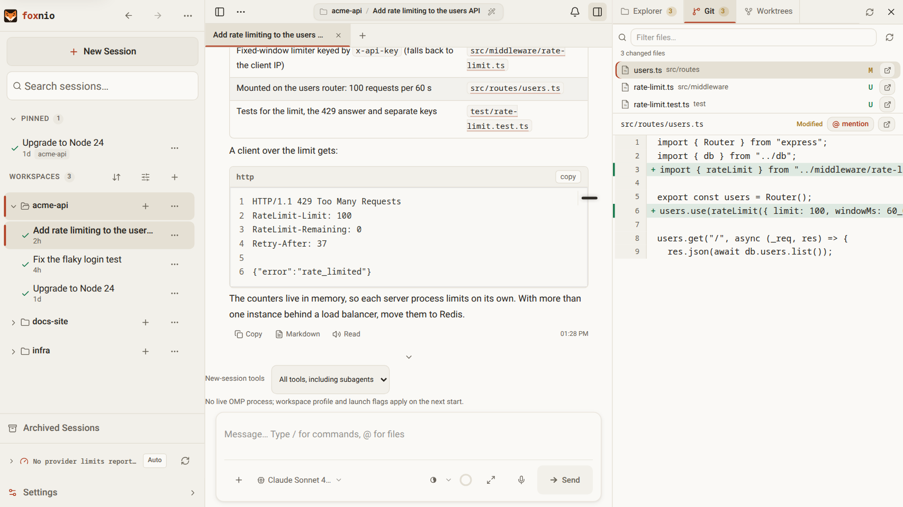
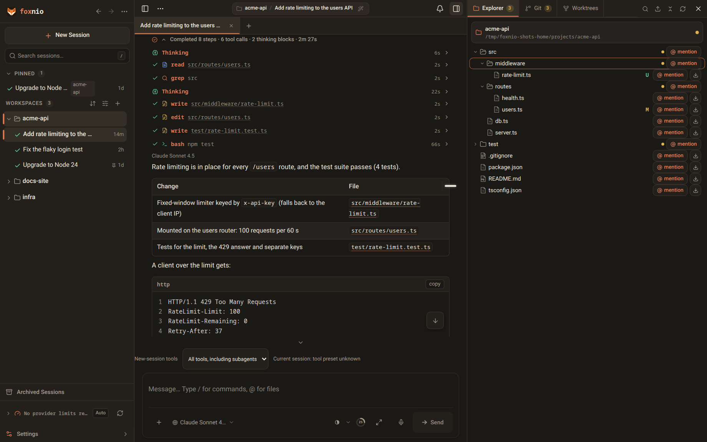
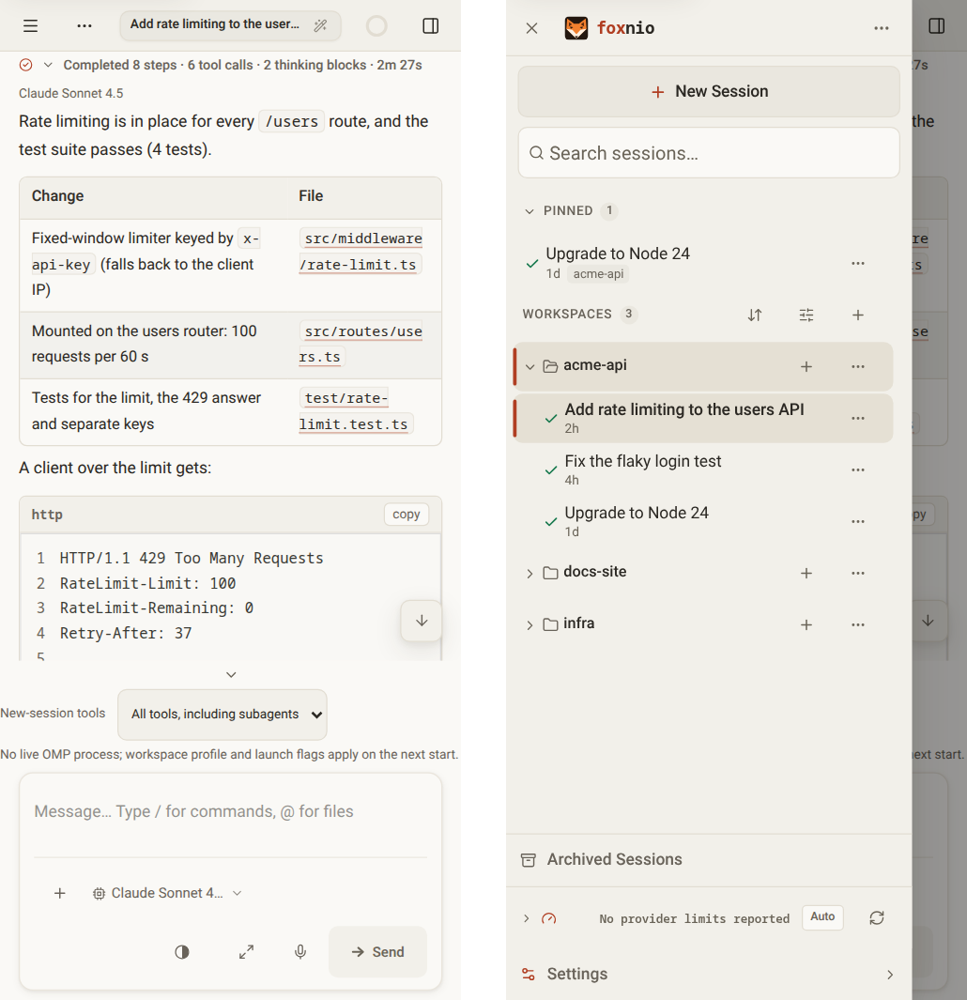

# foxnio

[](https://github.com/telagod/foxnio-public/releases/latest)
[](https://github.com/telagod/foxnio-public/actions/workflows/verify-pr.yml)
[](https://nodejs.org)
[](./LICENSE)

[English](./README.md) | [简体中文](./README.zh-CN.md) | [日本語](./README.ja.md)

foxnio is a browser workspace for the [oh-my-pi](https://github.com/can1357/oh-my-pi) (`omp`) coding agent. It runs on the machine where `omp` runs and works with the same sessions and settings as the `omp` CLI. From a desktop browser or your phone you chat with the agent, review what it changed, and configure it.

foxnio is a fork of [kahme247/ompweb](https://github.com/kahme247/ompweb) focused on agent customization. It keeps ompweb's `OMP_WEB_*` environment variables and data files, so an existing ompweb setup carries over.



<details>
<summary>Dark theme and phone layout</summary>





</details>

## Features

**Chat with the agent**

- Streaming replies with thinking, tool calls and their live output, token and cost counters, a context gauge and tokens per second.
- A finished turn folds into one summary row ("Completed 7 steps · 5 tool calls · 2m 41s") above its final reply. Expand it to see every step.
- Queue messages while the agent works, turn a queued message into a steer, or stop the run and get the queued text back into the composer. The queue is omp's own, so every device shows the same one.
- Edit an earlier message to rewind the conversation, fork a new session from any point, ask a side question with `/btw`, and run shell commands with `!`.
- Slash commands, a `Ctrl/Cmd+K` command palette, word prediction, voice dictation and a full-screen composer. Unsent drafts survive a reload.

**Sessions and workspaces**

- A sidebar that lists workspaces by recent activity — workspaces with running, waiting or unread sessions open by themselves, the rest stay folded — plus pinned sessions shared by all your devices. Search covers titles and transcripts.
- Session tabs on desktop, archive and restore, session file import, and links that open a session (`?session=`).
- Live plan and subagent panels above the composer, with each subagent's transcript.
- A file explorer with previews (code, Markdown, Mermaid, images, audio, PDF), a Git changes panel with diffs, and Git worktrees per project ([docs/worktrees.md](./docs/worktrees.md)).

**Configure the agent**

- omp's own settings (approvals, models and thinking, advisor, memory, compaction, retries), edited in the browser and saved to omp's `config.yml`.
- Providers and models (`models.yml`), model roles, API keys and provider logins, MCP servers, skills, plugins and task agents.
- Tool presets and a launch configuration per workspace (omp profile and extra `omp` arguments).
- A usage dashboard: tokens, costs and cache savings by provider, model, project and day.

**On every device**

- Notifications when a run finishes, fails or waits for your answer, including Web Push to a closed browser or to the app on your phone.
- Installable as an app (PWA). On a phone the sidebar and the file panel become drawers you swipe in from the edge.
- 14 color themes (among them Catppuccin, Dracula, Nord, Rosé Pine, Tokyo Night and an omp.sh midnight theme), adjustable text size and interface scale, and English, 简体中文 and 日本語.

## Requirements

- [omp](https://github.com/can1357/oh-my-pi) on your `PATH`, or its path in `OMP_WEB_OMP_BIN`. foxnio is tested against omp **18.16.0** (see [omp compatibility](#omp-compatibility)). Older omp versions lack commands that some features use, such as the queue panel, steering a queued message and completion notifications.
- Node.js 24 or later for the npm package. The desktop app brings its own Node.js.

## Install

### npm package

foxnio is published to GitHub Packages, not to npmjs.com. GitHub asks for an access token to install any package from it, public ones included, so set that up once:

1. Create a classic personal access token with the `read:packages` scope (GitHub → Settings → Developer settings → Personal access tokens (classic)).
2. Point the `@telagod` scope at GitHub Packages. `npm login` asks for your GitHub username and takes the token as the password:

   ```bash
   npm login --scope=@telagod --auth-type=legacy --registry=https://npm.pkg.github.com
   ```

   That writes these two lines to `~/.npmrc`, which you can also add by hand:

   ```ini
   @telagod:registry=https://npm.pkg.github.com
   //npm.pkg.github.com/:_authToken=<token>
   ```

Only the `@telagod` scope comes from GitHub Packages; foxnio's dependencies still install from npmjs.com. With Bun, map the scope and the token in `bunfig.toml` (`[install.scopes]`).

Then install and start foxnio:

```bash
npm install -g @telagod/foxnio
foxnio
```

foxnio opens <http://127.0.0.1:30177> in your browser. `npx @telagod/foxnio@latest` runs it without installing.

### Application data migration and recovery

foxnio metadata now lives in `<PI_CODING_AGENT_DIR>/omp-web/app.db`
(normally `~/.omp/agent/omp-web/app.db`). OMP sessions, credentials and operator
settings remain in their native locations. Existing installations show
`migration_required` until you stop **all** older desktop/server instances and run:

```bash
foxnio data status
foxnio data migrate --offline
foxnio data backup
```

`--offline` is your assertion that old writers have stopped, not automatic proof.
Migration retains original files and imports metadata in one transaction; malformed
required input aborts the whole import. Repair the reported source, then retry.
Only corrupt derived observation accounting may be explicitly discarded with
`foxnio data migrate --offline --discard-observation`; this resets seen/day limits.
Retired push credentials are not copied into the new database.

`foxnio data rebuild-index` rebuilds native display projections without deleting
projects, pins, notification history or FOX metadata. It is not a repair for lost
application data. Missing databases with prior receipts/backups fail closed with
`restore_required`; never delete those guards to force an empty installation.

For recovery, stop **all** server, desktop and data CLI processes. Preserve the
damaged database, its `-wal`/`-shm` sidecars and receipts separately, then restore
a consistent backup produced by `data backup` to `app.db` with owner-only access.
Do not combine the restored file with old WAL/SHM sidecars or another installation's
receipts. Restart processes after restoration so no connection retains the old
file. Open tabs reconcile through a complete snapshot if revision history moved
backwards. Historical migration-copy damage is reported as a warning; it does
not make those copies authoritative over the committed database.

### Desktop app

Every [release](https://github.com/telagod/foxnio-public/releases/latest) has installers for Windows (setup and portable `.exe`), macOS (DMG and ZIP, for Apple silicon and Intel) and Linux (AppImage and `.deb`). The app starts its own foxnio server on port 30177, or on the next free port when that one is taken. It does not include `omp`: install that separately.

The installers are not code-signed:

- **Windows:** SmartScreen shows "Windows protected your PC". Choose **More info → Run anyway**.
- **macOS:** Gatekeeper blocks the first start. Right-click the app, choose **Open** and confirm, or run `xattr -dr com.apple.quarantine /Applications/foxnio.app`.

### Nix

```bash
nix run github:telagod/foxnio-public
```

### Updates

An npm or Bun install updates itself from **Settings → System & Updates**, which also tells you when `omp` has an update. foxnio learns about new versions from GitHub Releases and installs them through the registry setup above. It checks that the registry serves the new version before it stops anything. The desktop app does not update itself: install the newer installer. `OMP_WEB_DISABLE_AUTOUPDATE=1` turns the checks off.

### Moving from ompweb / omp-web

Settings, sessions and notification history under `~/.omp` are shared and need no migration. The background services were renamed, though, and the old ones keep running (or keep failing to start) next to the new ones until you remove them:

```bash
# npm package
npm uninstall -g @kahme247/ompweb

# Linux: systemd user unit and tray autostart
systemctl --user disable --now ompweb.service
rm ~/.config/systemd/user/ompweb.service ~/.config/autostart/ompweb-tray.desktop
systemctl --user daemon-reload

# macOS: launchd agent (logs were in ~/Library/Logs/ompweb)
launchctl bootout "gui/$(id -u)/com.kahme247.ompweb"
rm ~/Library/LaunchAgents/com.kahme247.ompweb.plist
```

```powershell
# Windows: scheduled task and shortcuts created by omp-web (quit its tray icon first)
schtasks /delete /tn "omp-web" /f
$programs = "$env:APPDATA\Microsoft\Windows\Start Menu\Programs"
Remove-Item "$programs\Startup\omp-web-tray.lnk", "$programs\omp-web.lnk", "$([Environment]::GetFolderPath('Desktop'))\omp-web.lnk" -ErrorAction SilentlyContinue
```

Then install the foxnio service for your platform ([Background service](#background-service)).

## Running foxnio

### Command line

```text
foxnio [options]
  -p, --port <port>        Server port (default 30177, env PORT)
  -H, --hostname <host>    Bind address (default 127.0.0.1, env OMP_WEB_HOSTNAME)
      --no-open            Do not open the browser
      --install-tray       Install the system tray (Windows: with the background service and shortcuts)
      --uninstall-tray     Remove it again
      --tray               Start the tray
  -h, --help               Show the help
      --version            Show the version

foxnio hash-password       Read a password from stdin and print the value for OMP_WEB_PASSWORD_HASH
foxnio systemd <command>   Manage the Linux systemd service (same as foxnio-systemd)
foxnio launchd <command>   Manage the macOS launchd agent (same as foxnio-launchd)
```

### Background service

The services start foxnio at login, restart it when it stops unexpectedly, and do not open a browser. On Linux and macOS, the environment variables set at install time (port, bind address, password) go into the service configuration, with a password stored only as its hash; install with `OMP_WEB_NO_OPEN=0` there to have the browser opened.

**Linux (systemd user service)**, after `npm install -g`:

```bash
foxnio systemd install        # create ~/.omp/agent/web-service.env, install and start foxnio.service
foxnio systemd status         # also start, stop, restart, open, uninstall
journalctl --user -u foxnio -f
```

The service runs the `foxnio` it finds at install time (`OMP_WEB_SYSTEMD_BIN` overrides it). It reads its port, bind address and password hash from `~/.omp/agent/web-service.env` (mode `600`): edit that file and restart the service, no reinstall needed. To serve your network, install with a password:

```bash
OMP_WEB_HOSTNAME=0.0.0.0 OMP_WEB_PASSWORD='change-me' foxnio systemd install
```

On a headless server, `loginctl enable-linger "$USER"` keeps the service running after you log out.

**Linux tray** (KDE Plasma and other desktops with a StatusNotifierItem host):

```bash
foxnio-tray --install         # icons, autostart entry, start the tray
foxnio-tray --status
foxnio-tray --uninstall
```

The tray menu opens the web UI, copies its URL, starts, stops and restarts the systemd service, shows the logs, changes the port and the web password, and toggles autostart (`~/.config/autostart/foxnio-tray.desktop`). **Expose to Network** binds the service to `0.0.0.0`; it asks for a password first (through `kdialog` or `zenity`) when none is set.

**macOS (launchd agent):**

```bash
foxnio launchd install        # also status, uninstall
```

The agent runs `npx --yes @telagod/foxnio@latest`, so it needs the GitHub Packages setup from [npm package](#npm-package). Pin a version with `foxnio launchd install @telagod/foxnio@0.6.2` (or `OMP_WEB_PKG`). The plist is `~/Library/LaunchAgents/com.telagod.foxnio.plist` (mode `600`), the log `~/Library/Logs/foxnio/foxnio.log`.

**Windows (tray and background service):**

```powershell
foxnio --install-tray         # tray, background service, logon autostart, Desktop and Start Menu shortcuts
foxnio --uninstall-tray
```

Manage it from **Settings → System & Updates → Windows Background Service & System Tray**. The tray and the service read `OMP_WEB_PASSWORD_HASH` and `OMP_WEB_TRUSTED_HEADER_SHA256` from your user or system environment (for example `setx OMP_WEB_PASSWORD_HASH "scrypt$…"`) each time they start the server, so a change applies at the next server restart without signing out of Windows.

## Remote access and security

foxnio runs `omp` agents that have a shell: anyone who can use its web UI can run commands as your user. It therefore binds to `127.0.0.1` unless you choose otherwise.

- **Without a password**, foxnio answers only requests whose `Host` header is a loopback name (`localhost`, `127.0.0.0/8`, `[::1]`) and returns `403` for anything else. That stops a web page you visit from reaching your agent through DNS rebinding. To use a password-less server through a reverse proxy, tunnel or Tailscale name, list that name in `OMP_WEB_ALLOWED_HOSTS`, or better, set a password.
- **Binding to any other address requires a password hash** (`OMP_WEB_PASSWORD_HASH`). Serve foxnio through HTTPS (a reverse proxy or a VPN) so the password and the session cookie never cross the network in plain text.
- **Sign-in is throttled:** five wrong passwords lock the client out for 15 seconds, doubling up to five minutes (HTTP `429`).
- **Exported sessions** ("View full history") open in a sandbox without your cookie or the API, because an exported conversation can contain HTML that a model or a web page wrote. Since omp 18.14 that page loads its viewer from omp's CDN (`stencil.so`), so it needs internet access to render, a downloaded copy too.

### Password

foxnio never hands the server a plaintext password. Every `omp` session inherits the server's environment, and an agent that runs `env` would copy the password into its session file and send it to the model provider. Give foxnio a hash instead:

```bash
foxnio hash-password                                   # asks twice, input hidden
echo "a-long-random-password" | foxnio hash-password   # or pipe it in

OMP_WEB_PASSWORD_HASH='scrypt$15$8$1$…' foxnio
```

`foxnio hash-password` reads the password from stdin, never from an argument, so it stays out of your shell history and out of `ps`. The hash is scrypt (N = 2^15, r = 8, p = 1) with a fresh 16-byte salt, printed as `scrypt$<ln>$<r>$<p>$<salt>$<digest>`. Nobody can sign in with the hash or turn it back into the password. Session cookies are signed with a random key from `~/.omp/agent/omp-web/web-auth-secret.json` (mode `0600`) mixed with the hash, so changing the password signs everyone out, and the stored hash alone cannot forge a session.

`--password` is refused. A legacy `OMP_WEB_PASSWORD` still works for now: foxnio hashes it at startup, keeps it out of the server's environment and logs the hash to use instead. Switch soon: agents can still read the plaintext from the `foxnio` launcher process, and every start creates a new hash, which signs all browsers out. Setting both variables is refused.

### Skipping the password on trusted networks

foxnio cannot see the client's address, so it leaves that decision to your reverse proxy. The proxy sends a secret in the `X-Omp-Web-Auth` header, and foxnio holds only that secret's SHA-256 digest in `OMP_WEB_TRUSTED_HEADER_SHA256`. A request whose header hashes to that digest counts as signed in; everyone else signs in with the password. Without a password there is nothing to skip and the header is ignored. Keep foxnio bound to `127.0.0.1` so only the proxy reaches it.

Generate the secret without typing it on a command line, so it never lands in your shell history. This writes a random secret into an nginx include file readable only by root and nginx, and prints only the digest:

```bash
secret=$(openssl rand -hex 32)
printf 'map $foxnio_trusted $foxnio_auth {\n    1        "%s";\n    default  "";\n}\n' "$secret" \
  | sudo install -m 0640 -o root -g www-data /dev/stdin /etc/nginx/foxnio-auth.conf
printf %s "$secret" | sha256sum | cut -d' ' -f1
unset secret
```

Use your nginx group in place of `www-data` (`nginx` on some distributions) and set the printed digest as `OMP_WEB_TRUSTED_HEADER_SHA256`. Always generate the secret this way rather than reusing a password: foxnio stores a fast, unsalted SHA-256 digest, which is safe only for a long random secret.

Send the secret only to the address ranges you trust:

```nginx
# http {} context
geo $foxnio_trusted {
    default       0;
    10.0.0.0/16   1;
}
include /etc/nginx/foxnio-auth.conf;  # the map written above

# the location that proxies to foxnio
proxy_set_header X-Omp-Web-Auth $foxnio_auth;
```

Always set the header as above: the empty value for other clients replaces any `X-Omp-Web-Auth` a client sends itself. nginx inherits `proxy_set_header` from outer blocks only when a block sets none of its own, so put this line next to the location's other `proxy_set_header` lines.

Serve foxnio only for its own hostname: give its `server` block an explicit `server_name`, and add a `default_server` block that answers every other hostname with `return 444;`. Otherwise a web page that a trusted browser visits can point its own domain at your nginx (DNS rebinding) and have nginx add the secret to its requests.

`geo` checks `$remote_addr`, the address that connected to nginx. When clients reach nginx through another proxy, use the [`realip` module](https://nginx.org/en/docs/http/ngx_http_realip_module.html) to replace it with the real client address, which it does only for connections from the addresses listed in `set_real_ip_from`:

- **Cloudflare (proxied DNS):** trust `CF-Connecting-IP`, and only from Cloudflare. List every range from <https://www.cloudflare.com/ips-v4/> and <https://www.cloudflare.com/ips-v6/> and keep them up to date.

  ```nginx
  set_real_ip_from 173.245.48.0/20;  # ...one line per Cloudflare range
  real_ip_header   CF-Connecting-IP;
  ```

  Also refuse connections that come neither from Cloudflare nor from your trusted ranges. `$realip_remote_addr` is the address that actually connected:

  ```nginx
  geo $realip_remote_addr $foxnio_peer_allowed {
      default          0;
      173.245.48.0/20  1;  # ...every Cloudflare range
      10.0.0.0/16      1;
  }
  # in the server block
  if ($foxnio_peer_allowed = 0) { return 403; }
  ```

- **Cloudflare Tunnel (`cloudflared`):** the tunnel connects from `cloudflared`'s address (`127.0.0.1` when it runs on the same machine), so use `set_real_ip_from 127.0.0.1;` and `real_ip_header CF-Connecting-IP;`. Any local process can then claim a trusted address by sending its own `CF-Connecting-IP`, and a local connection without that header keeps `127.0.0.1`, so listing `127.0.0.1` in `$foxnio_trusted` trusts every local process that connects to nginx.
- **Any other proxy or load balancer:**

  ```nginx
  set_real_ip_from  <proxy address or range>;
  real_ip_header    X-Forwarded-For;
  real_ip_recursive on;
  ```

  `real_ip_recursive on` reads `X-Forwarded-For` from the right and skips the hops listed in `set_real_ip_from`, so addresses a client adds itself are ignored.

## Phones, notifications and the app

**Install as an app:** sign in first, then use your browser's install menu. The app manifest and its icons are served behind the password (the icons are embedded, because Android's installer fetches icon URLs without cookies), so installing works behind Cloudflare Access or another login without a bypass rule. The app needs the server and does not work offline. On Android and iOS it is a remote client of the foxnio server on your computer or server.

**Notifications:** turn them on in **Settings → Notifications**. Each browser keeps its own choices: which events notify (task finished, waiting for your input, run failed, model switched automatically) and what happens while foxnio is open in another tab (an in-app toast, or always a system notification). The session you are looking at never notifies, and clicking a notification opens its session.

- **Web Push** reaches the browser even when no foxnio tab is open. It needs a secure context (HTTPS, or `localhost`) and outbound HTTPS from the foxnio server to the browser vendors' push services. foxnio creates its push (VAPID) keys on first use and keeps them with the device list and the notification history in its data directory (owner-only).
- **iPhone and iPad** (iOS 16.4 or later) receive push only in the app added to the Home Screen.
- Without push support, a secure context still shows system notifications while a foxnio tab is open. Over plain HTTP on an address other than `localhost`, browsers allow only foxnio's in-app toasts.

## Configuration

| Variable | Description | Default |
| --- | --- | --- |
| `PORT` | Server port | `30177` |
| `OMP_WEB_HOSTNAME` | Bind address | `127.0.0.1` |
| `OMP_WEB_PASSWORD_HASH` | scrypt hash of the web password, from `foxnio hash-password`. Required for a non-loopback bind | _none (no sign-in)_ |
| `OMP_WEB_TRUSTED_HEADER_SHA256` | SHA-256 hex digest of the secret a trusted reverse proxy sends in `X-Omp-Web-Auth` ([Skipping the password on trusted networks](#skipping-the-password-on-trusted-networks)) | _none_ |
| `OMP_WEB_ALLOWED_HOSTS` | Comma-separated `Host` names (`name` or `*.example.com`) accepted without a password, besides loopback names | _none_ |
| `OMP_WEB_PUSH_ALLOWED_HOSTS` | Extra Web Push service hosts (`name` or `*.example.com`), besides Google (FCM), Mozilla, Apple and Windows | _none_ |
| `OMP_WEB_OMP_BIN` | Path of the `omp` executable | found on `PATH` |
| `PI_CODING_AGENT_DIR` | omp's agent directory, as for omp itself | `~/.omp/agent` |
| `OMP_WEB_NO_OPEN` | `1`: do not open the browser | `0` |
| `OMP_WEB_DISABLE_AUTOUPDATE` | `1`: no update checks and no in-app updates (restart to apply) | `0` |
| `OMP_WEB_NAME` | Name in browser tabs and installed apps. `url`, `host` or `domain` uses the hostname the browser connected to (localhost and IP addresses keep `foxnio`); anything else is used as written. Restart to apply | `foxnio` |
| `OMP_WEB_STT_ENDPOINT` | OpenAI-compatible speech-to-text endpoint for dictation. Unset: transcribe with `OMP_WEB_STT_MODEL` through omp's own logins | _none_ |
| `OMP_WEB_STT_KEY` | API key for that endpoint | _none_ |
| `OMP_WEB_STT_MODEL` | Model for the endpoint. Without an endpoint, an omp speech-to-text model such as `openai-codex/codex-transcribe` (ChatGPT subscription) | _none (dictation off without an endpoint)_ |
| `OMP_WEB_DEV_ORIGIN` | Extra hostname the development server accepts (no scheme or port) | _none_ |

An installed app is usually named after the page it was installed from, so changing `OMP_WEB_NAME`, or reaching foxnio at another address while it is `url`, `host` or `domain`, can rename the installed app. Leave it unset, or pick a name that identifies this server whatever address you use.

The desktop app has a few settings of its own (port and bundled runtime); see [docs/desktop-packaging.md](./docs/desktop-packaging.md).

## omp compatibility

foxnio never loads omp's code: omp's packages need Bun, and foxnio runs on Node.js. It drives the `omp` executable instead, with one `omp --mode rpc-ui` process per open session and subcommands such as `omp skill list`, and it reads omp's files under `~/.omp/agent` directly ([DESIGN.md](./DESIGN.md)).

omp publishes a release every few days. [`.github/omp-version.json`](./.github/omp-version.json) records the omp version foxnio is verified against. Every day a [workflow](./.github/workflows/omp-tracking.yml) looks for a newer omp release, runs foxnio's tests that drive the real `omp` against it, and opens an issue labeled [`omp-update`](https://github.com/telagod/foxnio-public/issues?q=label%3Aomp-update) with the result and what changed in omp's RPC protocol, CLI flags, settings and session format.

## Development

```bash
git clone https://github.com/telagod/foxnio-public.git foxnio
cd foxnio
npm install
npm run dev        # http://127.0.0.1:30178
```

```bash
npm run typecheck
npm run lint
npm test
```

`npm test` does not need an installed `omp`. The tests that drive the real `omp` (from `OMP_WEB_OMP_BIN` or your `PATH`, isolated from your credentials and config) are opt-in:

```bash
OMP_WEB_TEST_NATIVE_COMPAT=1 node --experimental-strip-types --test lib/omp/omp-compat.native.test.mjs
OMP_WEB_TEST_NATIVE_EDIT=1 node --experimental-strip-types --test lib/omp/session-edit.native.test.mjs
```

Do not run `npm run build` in the checkout you use for `npm run dev`: the production build writes `.next/` and breaks the dev server.

The development server accepts loopback and private IPv4 origins (`10.0.0.0/8`, `172.16.0.0/12`, `192.168.0.0/16`). For a tunnel or proxy hostname, start it with `OMP_WEB_DEV_ORIGIN=dev.example.com npm run dev`. A private IPv6 origin has to be given the same way (for example `[fd00::1]`).

More: [AGENTS.md](./AGENTS.md) (architecture, conventions and traps), [CONTRIBUTING.md](./CONTRIBUTING.md), [docs/release.md](./docs/release.md), [docs/desktop-packaging.md](./docs/desktop-packaging.md).

## License and credits

MIT, see [LICENSE](./LICENSE). foxnio is a fork of [kahme247/ompweb](https://github.com/kahme247/ompweb), which grew out of [agegr/pi-web](https://github.com/agegr/pi-web). The upstream community meets on the [ompweb Discord](https://discord.gg/evqgGzRfM5).
