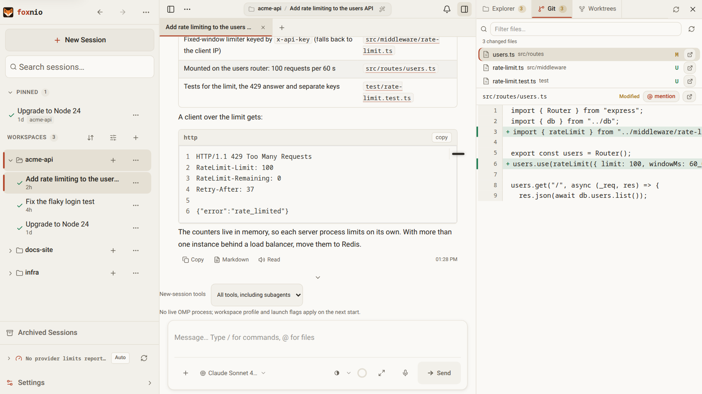
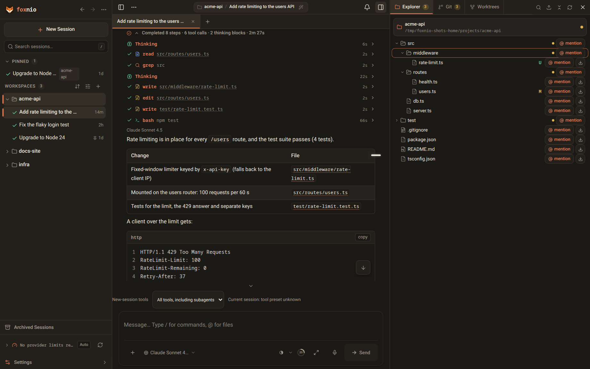

# foxnio

[](https://github.com/telagod/foxnio-public/packages)
[](https://nodejs.org)
[](./LICENSE)
[](https://github.com/telagod/foxnio-public/stargazers)
[](https://github.com/telagod/foxnio-public/pulls)

[English](./README.md) | [简体中文](./README.zh-CN.md) | [日本語](./README.ja.md)

foxnio 是 [kahme247/ompweb](https://github.com/kahme247/ompweb) 的 fork，专注于智能体定制。它仍通过 `OMP_WEB_*` 环境变量配置，已有的 `omp-web` 数据（设置、会话、通知历史）保持不变、可继续使用。

上游社区：[ompweb Discord](https://discord.gg/evqgGzRfM5)

[oh-my-pi (omp)](https://github.com/can1357/oh-my-pi) 编程智能体的现代 Web UI。它读取本地的 omp 会话，在浏览器中提供实时对话、项目会话浏览、配置管理和文件预览等功能。


<details>
<summary>截图（浅色 / 深色主题）</summary>





</details>

## 环境要求

- 已安装 [omp](https://github.com/can1357/oh-my-pi) 且在 `PATH` 中（或通过 `OMP_WEB_OMP_BIN` 指定路径）
- Node.js `>= 24`

将排队的后续消息转为 **Steer** 需要 omp 运行时支持 `promote_queued_message` RPC 命令（omp 18.1.16 尚不支持）。旧版运行时会返回错误，消息仍作为后续消息排队；foxnio 不会重复发送一条引导消息。

队列中的 **Delete** 和 **Edit** 还需要支持 `remove_queued_message`。只有 OMP 确认取消后才会移除消息；编辑时也必须先取消成功，再将文本恢复到输入框。运行时不支持该命令或消息已不在队列中时，界面保留队列并显示提示。

队列面板显示 omp 自身的队列（`get_state` 中的 `queuedMessages` 和 `queue_update` 事件，需 omp 18.4.4 或更高版本），因此查看同一会话的所有设备都会看到相同的排队消息。**Stop** 会将仍在队列中等待的消息文本放回输入框，而不是让智能体运行它们；但模型已通过实时引导接收的引导消息仍会运行。更早版本的 omp 不显示队列面板，Stop 也无法取回排队消息。

## 快速开始

> **尚未发布。** `@telagod/foxnio` 还没有发布到 GitHub Packages，GitHub Release 也还不存在。下面的命令要等首个版本发布后才可用。

foxnio 通过 GitHub Packages 分发，而不是公共 npm registry。GitHub 要求使用 access token 才能安装其中的任何包，Public 包也不例外。首次安装前：

1. 创建具有 `read:packages` 权限的 classic personal access token（GitHub → Settings → Developer settings → Personal access tokens (classic)）。
2. 将 `@telagod` scope 映射到 GitHub Packages，并把 token 写入用户级 npm 配置。`npm login` 会要求输入 GitHub 用户名，并把 token 当作密码：

```bash
npm login --scope=@telagod --auth-type=legacy --registry=https://npm.pkg.github.com
```

也可以手动在 `~/.npmrc` 中写入两行：

```ini
@telagod:registry=https://npm.pkg.github.com
//npm.pkg.github.com/:_authToken=<token>
```

只有 `@telagod` scope 使用 GitHub Packages，无 scope 的依赖仍从 npmjs 解析。使用 Bun 时，请用同一个 token 在 `bunfig.toml` 的 `[install.scopes]` 中映射该 scope。

应用内更新器执行同样的安装命令，需要同样的配置。它会在停止任何进程之前先确认新版本能从 registry 读取，读取不到时会提示缺少配置。

**免安装直接运行：**

```bash
npx @telagod/foxnio@latest
```

**或全局安装：**

```bash
npm install -g @telagod/foxnio
foxnio
```

在浏览器中打开 [http://127.0.0.1:30177](http://127.0.0.1:30177)。

### 桌面安装包

每个 GitHub Release（发布后）都会附带 Windows（NSIS 安装包和便携版 `.exe`）、macOS（DMG 和 ZIP）、Linux（AppImage 和 `.deb`）安装包。它们**没有代码签名或公证**：

- **Windows：** SmartScreen 会显示“Windows 已保护你的电脑”。选择 **更多信息 → 仍要运行**。
- **macOS：** Gatekeeper 会拦截首次启动。右键点击应用并选择 **打开** 后确认，或执行 `xattr -dr com.apple.quarantine /Applications/foxnio.app`。

桌面版仍需要另外安装 `omp`。它会在 30177 端口启动自己的本地服务，该端口被占用时改用下一个空闲端口，并且不使用应用内更新器：请安装新版安装包来更新。

### 从 ompweb / omp-web 迁移

改名为 foxnio 后，后台服务的名称也变了。旧服务会继续与新服务并存（或启动失败），需要手动删除。`~/.omp` 下的设置、会话和通知历史是共用的，无需迁移。

```bash
# npm 包
npm uninstall -g @kahme247/ompweb

# Linux：systemd 用户单元和托盘自启动
systemctl --user disable --now ompweb.service
rm ~/.config/systemd/user/ompweb.service ~/.config/autostart/ompweb-tray.desktop
systemctl --user daemon-reload

# macOS：launchd agent（日志在 ~/Library/Logs/ompweb）
launchctl bootout "gui/$(id -u)/com.kahme247.ompweb"
rm ~/Library/LaunchAgents/com.kahme247.ompweb.plist
```

```powershell
# Windows：omp-web 创建的计划任务和快捷方式（先退出其托盘图标）
schtasks /delete /tn "omp-web" /f
$programs = "$env:APPDATA\Microsoft\Windows\Start Menu\Programs"
Remove-Item "$programs\Startup\omp-web-tray.lnk", "$programs\omp-web.lnk", "$([Environment]::GetFolderPath('Desktop'))\omp-web.lnk" -ErrorAction SilentlyContinue
```

之后重新安装 foxnio 的服务（`foxnio systemd install`、`foxnio-launchd install`、`foxnio --install-tray`）。

### CLI 选项

```bash
foxnio --port 8080                         # 自定义端口
foxnio --hostname 0.0.0.0                  # 监听网络地址
foxnio hash-password                      # 输出 OMP_WEB_PASSWORD_HASH 的值
foxnio --no-open                           # 不自动打开浏览器
```

### 密码保护

foxnio **绝不把明文密码交给服务器**：每个 `omp` 会话都会继承服务器的环境变量，
智能体只要运行 `env` 就会把密码写入会话文件并发送给模型提供商。使用
`--password` 会导致启动被拒绝。`OMP_WEB_PASSWORD` 暂时仍可使用：`foxnio`
会在启动时将其哈希、使其不进入服务器的环境变量，并在日志中输出警告，附上应设置为
`OMP_WEB_PASSWORD_HASH` 的哈希值。请尽快切换：智能体仍能从 `foxnio` 启动器进程中
读取明文，而且每次启动都会生成新的哈希，每次重启都会让所有浏览器退出登录。
同时设置两个变量会导致启动被拒绝，请删除 `OMP_WEB_PASSWORD`。

请改用哈希：

```bash
foxnio hash-password                       # 输入两次，内容不回显
echo "a-long-random-password" | foxnio hash-password   # 也可通过管道输入

OMP_WEB_PASSWORD_HASH='scrypt$15$8$1$…' foxnio
```

`foxnio hash-password` 从标准输入读取密码（绝不作为命令行参数），因此不会
留在 shell 历史或 `ps` 输出中。哈希使用 scrypt（N = 2^15、r = 8、p = 1）
与 16 字节随机盐，输出格式为 `scrypt$<ln>$<r>$<p>$<salt>$<digest>`。
即使读到哈希也无法用它登录，更无法还原出密码。

会话签名不使用密码哈希。首次启动时会生成随机签名密钥并保存到
`~/.omp/agent/omp-web/web-auth-secret.json`（权限 `0600`），再与哈希混合得到
签名密钥：修改密码会让已有会话失效，而仅凭保存的哈希无法伪造会话。

**未设置密码时**，foxnio 只响应 `Host` 头为回环名称（`localhost`、`127.0.0.0/8`、`[::1]`）的请求，其余一律返回 `403`，以防你访问的网页通过 DNS rebinding 访问本地智能体。如需通过反向代理、隧道或 Tailscale 域名访问未设密码的服务，请把该域名写入 `OMP_WEB_ALLOWED_HOSTS`（更推荐直接设置密码）。登录失败会被限速：连续输错 5 次，该客户端锁定 15 秒，之后逐次翻倍，最长 5 分钟（HTTP `429`）。

“查看完整历史”打开的导出会话页运行在沙箱中，无法读取你的会话 Cookie，也无法调用 API，因为导出的对话可能包含模型或网页写入的 HTML。

服务安装脚本（`foxnio systemd install`、`foxnio-launchd install`、Linux 托盘、
Windows 服务）仍在安装时接受 `OMP_WEB_PASSWORD`，但在写入配置前会先做哈希，
最终只保存哈希。

## 功能特性

- **实时对话**：与本地 `omp` 智能体进行低延迟流式交互。
- **队列删除确认**：取消 OMP 中排队的后续消息或引导消息前，先预览内容并确认。需要原生支持 `remove_queued_message`；已发送的消息无法撤回。
- **会话管理**：按项目浏览历史会话，支持会话分叉与分支回溯。
- **草稿恢复**：未发送的文本按会话或新会话的工作区分别保存；浏览器存储可用时，在同一标签页后退、前进或重新加载后可恢复（最多 50 份草稿）。图片和文件附件仅保留在内存中。
- **实时任务与子智能体**：可折叠面板实时展示任务清单（todo）与子智能体进度，并支持查看完整转录。
- **工具预设与工作区启动配置**：新浏览器默认选择与 CLI 一致的 `full` 工具集；`default` 仅开放 `read`、`bash`、`edit`、`write`，`full` 保留 OMP 全部默认工具（包括搜索和子代理）。聊天中会显示当前会话的工具集。可从侧边栏工作区菜单配置 OMP profile 和额外启动参数，保存后下次启动或重新加载时生效。
- **文件管理与预览**：与对话并排浏览文件，支持代码、Markdown、图片、音频及 PDF 预览。
- **Git Worktree 支持**：直接在侧边栏切换与管理 Git 工作树。
- **可视化设置**：在 Web 界面中直接配置模型、API 密钥、MCP 服务器、技能、插件及 OMP 原生设置。
- **快捷指令与命令面板**：内置常用指令（`/plan`、`/review`、`/fix`、`/test` 等）及 `⌘K` / `Ctrl+K` 全局面板。
- **主题与多语言**：温暖纸感深浅主题，完整支持英语、简体中文及日本語。

## 环境变量

| 变量 | 说明 | 默认值 |
| --- | --- | --- |
| `PORT` | 服务端口 | `30177` |
| `OMP_WEB_HOSTNAME` | 绑定主机名 | `127.0.0.1` |
| `OMP_WEB_PASSWORD_HASH` | Web 登录密码的 scrypt 哈希（由 `foxnio hash-password` 生成）。绑定非回环地址时必须设置 | _无（未启用验证）_ |
| `OMP_WEB_TRUSTED_HEADER_SHA256` | 受信任的反向代理在 `X-Omp-Web-Auth` 请求头中发送的密钥的 SHA-256 摘要（十六进制）；请求头哈希匹配的请求无需密码。foxnio 不保存密钥本身。生成方法和 nginx 配置示例见英文 README 的 “Skipping the password on trusted networks” 一节 | _无（未启用）_ |
| `OMP_WEB_ALLOWED_HOSTS` | 未设置密码时，除回环名称外额外接受的 `Host` 名称，逗号分隔（`name` 或 `*.example.com`） | _无_ |
| `OMP_WEB_PUSH_ALLOWED_HOSTS` | 除 Google（FCM）、Mozilla、Apple 和 Windows 外额外接受的 Web Push 服务主机名，逗号分隔（`name` 或 `*.example.com`） | _无_ |
| `OMP_WEB_NO_OPEN` | 设为 `1` 时禁止自动打开浏览器 | `0` |
| `OMP_WEB_DISABLE_AUTOUPDATE` | 设为 `1` 时禁用更新检查和应用内更新；修改后需重启 | `0` |
| `OMP_WEB_NAME` | 浏览器标签页和已安装应用中显示的名称。设为 `url`、`host` 或 `domain`（不区分大小写）时使用浏览器所连接的主机名（不含端口），localhost 和 IP 地址仍显示 `foxnio`；其他值按原样使用。修改后需重启 | `foxnio` |
| `OMP_WEB_OMP_BIN` | `omp` 二进制路径（未在 PATH 时使用） | _自动检测_ |
| `PI_CODING_AGENT_DIR` | 自定义 omp agent 目录 | `~/.omp/agent` |
| `OMP_WEB_STT_ENDPOINT` | OpenAI 兼容的语音转文字接口 URL。不设置时使用 `OMP_WEB_STT_MODEL` 通过 omp 自身的凭据转录 | _无_ |
| `OMP_WEB_STT_KEY` | STT 接口对应的 API Key | _无_ |
| `OMP_WEB_STT_MODEL` | STT 接口的模型名称。未设置接口时：使用 omp 登录凭据运行的 omp 语音转文字模型，例如 `openai-codex/codex-transcribe`（ChatGPT 订阅；需要包含该模型的 omp 版本） | _无（未设置接口时禁用）_ |

桌面安装包构建说明见 [`docs/desktop-packaging.zh-CN.md`](./docs/desktop-packaging.zh-CN.md)。桌面版是本地 foxnio 服务的 launcher：第一版安装包需要用户另外安装 `omp`，Android/iOS 继续通过 HTTPS 使用 PWA 远程连接。

**`OMP_WEB_NAME` 与已安装应用。** 已安装应用（PWA）通常以安装时所在页面的名称命名。如果之后修改了 `OMP_WEB_NAME`，或在 `OMP_WEB_NAME` 为 `url`、`host` 或 `domain` 时通过其他地址访问 foxnio，操作系统可能也会重命名已安装的应用。建议将 `OMP_WEB_NAME` 留空，或设置一个无论通过哪个域名或地址访问都能识别这台 foxnio 服务器的名称。

## 本地开发

```bash
git clone https://github.com/telagod/foxnio-public.git foxnio
cd foxnio
npm install
npm run dev
```

本地开发服务器运行在 [http://127.0.0.1:30178](http://127.0.0.1:30178)。

### 代码检查

```bash
npm run typecheck   # TypeScript 类型检查
npm run lint        # ESLint 检查
npm test            # 运行测试套件
```

> **注意**：本地开发期间请勿运行 `npm run build`，以免污染 `.next/` 导致开发服务器异常。

## 致谢与许可证

- 分叉自 [agegr/pi-web](https://github.com/agegr/pi-web)（MIT），针对 [can1357/oh-my-pi](https://github.com/can1357/oh-my-pi) 进行适配。
- 采用 [MIT 许可证](./LICENSE) 开源。
